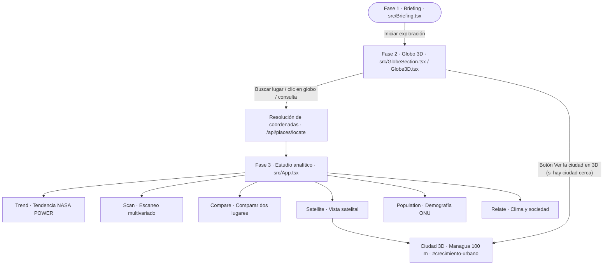
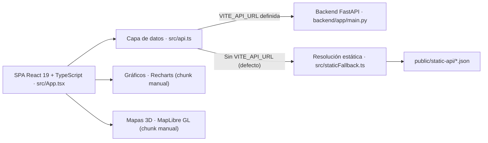

<a id="inicio"></a>

# DATEX — Especificación técnica del proyecto

<p align="center"></p>

**Boreal Labs · NASA Space Apps Challenge 2026**

**Web publicada:** [jose21nc.github.io/datex](https://jose21nc.github.io/datex/) · **Repositorio:** [GitHub · Jose21NC/datex](https://github.com/Jose21NC/datex) · **Licencia:** [MIT](LICENSE)

**Estado:** aplicación web estática operativa en producción (`dist/` desplegable sin backend obligatorio), acompañada de servidor API en `backend/` (Python + FastAPI) y datos precalculados en `public/static-api/`.

[Índice](#indice) · [Experiencia y vistas](#flujo) · [Datos y arquitectura](#arquitectura) · [Stack técnico](#stack) · [Ejecutar el proyecto](#instalacion)

**DATEX** responde a una pregunta concreta: *¿el clima está cambiando de verdad?* La plataforma separa la tendencia climática real de las variaciones estacionales o falsas alarmas utilizando más de 40 años de datos satelitales y reanálisis de la NASA (1981–presente), combinados con series demográficas de la ONU, indicadores del Banco Mundial y un escenario 3D de crecimiento urbano por celdas de ~100 m para Managua.

Este README es el documento principal de especificación técnica del repositorio. Describe el propósito del proyecto, el recorrido de la interfaz, las fuentes de datos, la arquitectura frontend/backend, los comandos de desarrollo y verificación, y las condiciones de despliegue. Más detalle técnico en [TECNICO.md](TECNICO.md).

<a id="indice"></a>

## Índice de lectura

| Área | Qué encontrarás | Accesos directos |
| --- | --- | --- |
| **01 · Proyecto** | Problema, alcance, capacidades y límites | [Propósito y alcance](#problema) · [Capacidades](#capacidades) · [Identidad y activos](#identidad) |
| **02 · Experiencia** | Recorrido en tres fases, globo 3D y estudio analítico | [Flujo de usuario](#flujo) · [Pestañas del estudio](#vistas) · [Escenario Ciudad 3D](#ciudad3d) |
| **03 · Datos y arquitectura** | Fuentes científicas, backend Python y modo estático | [Arquitectura](#arquitectura) · [Fuentes de datos](#fuentes) · [Static API y fallback](#static-api) |
| **04 · Desarrollo técnico** | Stack, estructura de archivos, comandos y despliegue | [Stack técnico](#stack) · [Organización del código](#estructura) · [Instalación y scripts](#instalacion) · [Despliegue](#despliegue) |
| **05 · Créditos y licencia** | Equipo, atribución de datos y licencia | [Créditos](#creditos) · [Licencia](#licencia) |

**Para desarrollar:** empieza por [stack técnico](#stack), [organización del código](#estructura) e [instalación y scripts](#instalacion). **Para comprender el proyecto:** sigue [propósito](#problema) → [flujo de usuario](#flujo) → [arquitectura](#arquitectura).

<details>
<summary><strong>Cómo leer este documento y el estado del código</strong></summary>

- **Implementado:** presente y verificable en el código fuente (`src/`, `backend/`, `public/static-api/`, `.github/workflows/`).
- **Modo estático por defecto:** sin configurar `VITE_API_URL`, la web funciona de forma autónoma consumiendo `public/static-api/` y replicando el cálculo estadístico en el navegador (`src/staticFallback.ts`).
- **Backend Python (`backend/`):** servidor FastAPI con motor estadístico en `backend/app/services/trends.py`, clientes de NASA/Planetary Computer/ONU/Banco Mundial y script de escenario urbano (`backend/scripts/build_city_growth.py`).
- **Escenario vs. predicción:** la vista **Ciudad 3D** (Managua) modela un escenario exploratorio de tendencia por celdas de ~100 m; **no** constituye un pronóstico determinista.

</details>

<a id="proyecto"></a>

# I. Proyecto y problemática

Contexto climático, propósito científico-divulgativo y límites explícitos de la plataforma.

<a id="problema"></a>

## 1. Problema, propósito y alcance

Interpretar el cambio climático a escala local suele verse distorsionado por eventos meteorológicos puntuales o variabilidad estacional. DATEX busca ofrecer un **veredicto honesto de tendencia** para cualquier coordenada del planeta, contrastando series mensuales de largo plazo con métricas estadísticas resistentes a la autocorrelación.

El proyecto comprende cuatro pilares funcionales:

1. **Briefing de entrada:** introducción visual en pantalla completa que contextualiza la pregunta central, la validación Monte Carlo y cuatro casos de demostración.
2. **Globo 3D interactivo (`Globe3D`):** exploración planetaria sobre 2.592 celdas de 5° con selección directa de coordenadas, búsqueda de lugares, consulta en lenguaje natural (`ask`) y selección guiada por preocupación climática y tipo de lugar.
3. **Estudio analítico (`Studio`):** seis pestañas especializadas para inspeccionar tendencia histórica, escaneo multivariado, comparación entre dos puntos, imágenes satelitales, demografía ONU frente al ritmo lineal y relación clima–sociedad.
4. **Escenario urbano 3D (`CityGrowth3D`):** simulación espacial por celdas de ~100 m sobre **Managua, Nicaragua**, vinculando expansión horizontal y densidad vertical con población urbana, ingreso y clima hasta 2050.

### Límites

- En modo estático (sin `VITE_API_URL`), el conteo detallado de cobertura del suelo e insignia de clima en vivo requieren el servidor Python; el resto de vistas opera desde `public/static-api/` y consultas directas a APIs públicas.
- Los datos completos del Banco Mundial incluidos de forma estática cubren **Nicaragua, México, Brasil y Argelia**.
- El escenario urbano 3D de Managua es exploratorio y no conoce planes urbanísticos ni sustituye estudios oficiales de ordenamiento territorial.

[↑ Volver al índice](#indice)

<a id="capacidades"></a>

## 2. Capacidades principales

| Capacidad | Descripción verificada en código | Alcance actual |
| --- | --- | --- |
| Tendencia climática | 17 variables mensuales NASA POWER desde 1981 (`TrendView`, `TrendChart`) | Global con pruebas resistentes a autocorrelación |
| Escaneo de variables | Barrido de las 17 variables con ajuste de p-valor (`ScanView`) | Completo en modo estático y backend |
| Comparación espacial | Contraste directo entre dos ubicaciones (`ComparePlaces`) | Selección desde búsqueda o clic en el globo |
| Imágenes satelitales | Consulta de imágenes y cobertura del suelo (`SatelliteView`) | Completo con backend; timeline en modo estático |
| Población y ritmo lineal | Series ONU frente a crecimiento lineal (`DemographyView`) | Datos World Population Prospects vía OWID |
| Relación clima–sociedad | Cruce de variables climáticas e indicadores socioeconómicos (`RelateView`) | Completo para Nicaragua, México, Brasil y Argelia |
| Ciudad 3D (Managua) | Escenario por celdas de ~100 m con `maplibre-gl` (`CityGrowth3D`) | Escenario `managua.json` (`12.13, -86.25`) |
| Bilingüe ES / EN | Diccionario completo de interfaz y textos explicativos (`src/i18n.ts`) | Cambio dinámico de idioma |

[↑ Volver al índice](#indice)

<a id="identidad"></a>

## 3. Identidad visual y activos

| Elemento | Especificación en el repositorio |
| --- | --- |
| Marca | **DATEX** · desarrollado por **Boreal Labs** |
| Activos gráficos | `public/logo.png`, `public/boreal-labs.png`, `public/favicon.png`, `public/shard-{top,bottom,left,right}.png` |
| Tipografía | **Satoshi** cargada desde Fontshare en `index.html` |
| Transiciones | `document.startViewTransition` en cambios de fase (`withTransition` en `src/App.tsx`) |

[↑ Volver al índice](#indice)

<a id="experiencia"></a>

# II. Experiencia y análisis

Recorrido de usuario en tres fases y módulos analíticos disponibles en la interfaz.

<a id="flujo"></a>

## 4. Flujo de usuario

La aplicación organiza la navegación mediante un estado de fase (`phase: 'briefing' | 'planet' | 'studio'`) en `src/App.tsx`:



1. **Briefing:** presenta la premisa del proyecto y permite ingresar al entorno espacial con transición suave.
2. **Planet:** muestra el globo interactivo (`Globe3D`) con selector de coordenadas, buscador de lugares, selector de preocupación climática, tipo de lugar y el botón **Ver la ciudad en 3D** cuando hay una ciudad precalculada cerca.
3. **Studio:** habilita el análisis detallado del punto elegido a través de las seis pestañas principales, tabla de datos (`DataTable.tsx`), gráficos (`SeriesChart.tsx`, `TrendChart.tsx`), explicaciones contextuales (`Explain.tsx`) y la sección `#crecimiento-urbano` en **Satélite**.

[↑ Volver al índice](#indice)

<a id="vistas"></a>

## 5. Pestañas y módulos del estudio

| Pestaña (`Tab`) | Componente principal | Función |
| --- | --- | --- |
| `trend` | `src/TrendView.tsx` | Veredicto de tendencia histórica, serie temporal y análisis estadístico |
| `scan` | `src/ScanView.tsx` | Barrido de las 17 variables climáticas para detectar señales relevantes |
| `compare` | `src/ComparePlaces.tsx` | Comparativa directa entre el punto principal y un segundo punto elegido en el globo |
| `satellite` | `src/SatelliteView.tsx` | Exploración satelital, cobertura del suelo y bloque `#crecimiento-urbano` |
| `population` | `src/DemographyView.tsx` | Evolución poblacional de la ONU comparada contra referencia lineal |
| `relate` | `src/RelateView.tsx` | Relación entre variables climáticas e indicadores del Banco Mundial |

[↑ Volver al índice](#indice)

<a id="ciudad3d"></a>

## 6. Escenario Ciudad 3D (Managua)

`src/CityGrowth3D.tsx` renderiza con **MapLibre GL** un escenario de crecimiento urbano por celdas de **~100 m × 100 m** centrado en Managua (`public/static-api/city/managua.json`, ~545 KB), registrado en `public/static-api/city/index.json` y generado por `backend/scripts/build_city_growth.py`:

- **Expansión horizontal y vertical:** celdas construidas proyectadas (2030–2050) impulsadas por población urbana, ingreso y variables climáticas.
- **Carga diferida:** `CityGrowth3D` y `Globe3D` se cargan con `React.lazy` para mantener ligero el chunk inicial.
- **Advertencia metodológica:** representa un escenario exploratorio de tendencia, no un pronóstico ni una predicción oficial.

[↑ Volver al índice](#indice)

<a id="datos-arquitectura"></a>

# III. Datos, fuentes y arquitectura

Flujo de datos entre la capa de cliente, el backend FastAPI y los activos estáticos.

<a id="arquitectura"></a>

## 7. Arquitectura de componentes



La configuración de Vite (`vite.config.ts`) utiliza `base: './'` para compatibilidad con GitHub Pages y separa `recharts` y `maplibre-gl` mediante `manualChunks`.

[↑ Volver al índice](#indice)

<a id="fuentes"></a>

## 8. Fuentes de datos científicas

| Fuente | Cobertura / Uso en DATEX |
| --- | --- |
| **NASA POWER** (MERRA-2 y CERES) | 17 variables climáticas mensuales desde 1981 para análisis de tendencia |
| **NASA GIBS** | Capas e insumos visuales satelitales (Blue Marble y Black Marble) |
| **Landsat y Sentinel-2** (vía Microsoft Planetary Computer) | Imágenes satelitales de observación terrestre |
| **ONU — World Population Prospects** (vía Our World in Data) | Series demográficas históricas y proyecciones |
| **Banco Mundial** | Indicadores socioeconómicos completos para Nicaragua, México, Brasil y Argelia |
| **Open-Meteo** | Búsqueda geográfica de lugares |
| **Esri / Impact Observatory** | Cobertura del suelo (*land cover*) |
| **Copernicus DEM** | Modelo digital de elevación |

[↑ Volver al índice](#indice)

<a id="static-api"></a>

## 9. Static API y modo sin backend

El directorio `public/static-api/` permite ejecutar toda la aplicación como sitio estático sin servidor propio:

| Archivo | Tamaño aproximado | Rol |
| --- | --- | --- |
| `public/static-api/bundle.json` | ~6.67 MB | Paquete consolidado de series y respuestas estáticas |
| `public/static-api/city/managua.json` | ~545 KB | Malla de celdas de ~100 m para el escenario Ciudad 3D |
| `public/static-api/globe.json` | ~471 KB | Malla global de 2.592 celdas de 5° para el globo 3D |
| `public/static-api/catalog.json` | ~17.7 KB | Catálogo de lugares, variables y metadatos |
| `public/static-api/city/index.json` | 131 B | Índice de escenarios urbanos disponibles (`managua`) |

En `src/api.ts`, `hasBackend` es `true` únicamente cuando `import.meta.env.VITE_API_URL` está definida. Si está vacía, las peticiones son resueltas por `src/staticFallback.ts` con temporización controlada (`paced()`).

[↑ Volver al índice](#indice)

<a id="desarrollo"></a>

# IV. Especificación para desarrollo

Tecnologías registradas, estructura de archivos, comandos de desarrollo/pruebas y despliegue.

<a id="stack"></a>

## 10. Stack técnico

| Capa | Tecnología (`package.json` / `pyproject.toml`) | Propósito |
| --- | --- | --- |
| Framework UI | `react` `^19.3.1`, `react-dom` `^19.3.1` | Interfaz declarativa y carga diferida (`lazy`/`Suspense`) |
| Lenguaje Web | `typescript` `~7.0.2` | Tipado estricto (`tsc -b`) |
| Empaquetador | `vite` `^8.3.6`, `@vitejs/plugin-react` `^6.1.2` | Servidor local HMR y build estático en `dist/` |
| Mapas y 3D | `maplibre-gl` `^5.24.1` | Globo 3D y escenario urbano 3D en `CityGrowth3D` |
| Gráficos | `recharts` `^3.10.1` | Series temporales, tendencias y correlaciones |
| Linter Web | `oxlint` `^1.90.0` (`.oxlintrc.json`) | Reglas para `react`, `typescript` y `oxc` |
| Backend API | Python ≥ 3.11, FastAPI, NumPy, pandas, SciPy, `uv` | Motor estadístico, clientes de datos y pruebas (`pytest`, `ruff`) |

[↑ Volver al índice](#indice)

<a id="estructura"></a>

## 11. Organización del código

```text
.github/workflows/             ci.yml (backend + web) y deploy.yml (GitHub Pages)
backend/
  app/                         API FastAPI, catálogo y servicios estadísticos/climáticos
  scripts/                     build_globe.py, export_static_api.py, fetch_samples.py, build_city_growth.py
  tests/                       Suite de pruebas pytest
public/
  static-api/                  Datos precalculados (bundle, globe, catalog, city)
  logo.png / boreal-labs.png   Identidad visual y favicon
  shard-*.png                  Recursos gráficos de interfaz
src/
  App.tsx                      Orquestación de fases (briefing, planet, studio) y pestañas
  Briefing.tsx                 Pantalla de introducción
  Globe3D.tsx / GlobeSection.tsx  Globo 3D y controles de selección espacial
  TrendView.tsx / TrendChart.tsx  Análisis de tendencia climática
  ScanView.tsx                 Escaneo multivariado de indicadores
  ComparePlaces.tsx            Comparación entre dos coordenadas
  SatelliteView.tsx            Vista satelital y sección #crecimiento-urbano
  DemographyView.tsx           Población ONU vs. ritmo lineal
  RelateView.tsx               Relación clima–sociedad (Banco Mundial)
  CityGrowth3D.tsx             Escenario urbano 3D por celdas de ~100 m (Managua)
  SeriesChart.tsx / DataTable.tsx / Explain.tsx  Componentes analíticos compartidos
  api.ts / staticFallback.ts   Cliente HTTP y resolución offline/estática
  cities.ts / globeColors.ts   Catálogo auxiliar de ciudades y paletas del globo
  i18n.ts / ui.tsx / index.css Diccionario ES/EN, primitivas UI y estilos globales
```

[↑ Volver al índice](#indice)

<a id="instalacion"></a>

## 12. Instalación, scripts y verificación

### Solo la web (modo estático)

```bash
npm install
npm run dev
```

Abre `http://localhost:5173`. Sin servidor, la web usa `public/static-api/` y calcula en el navegador.

### Web + servidor (`backend/`)

Requiere [uv](https://docs.astral.sh/uv/):

```bash
cp .env.example .env    # define VITE_API_URL=http://localhost:8000; las claves son opcionales
make setup
make backend            # API en http://localhost:8000 (/docs)
make web                # en otra terminal
```

### Scripts y verificación

| Comando | Finalidad |
| --- | --- |
| `npm run lint` | Análisis estático con `oxlint` |
| `npm run build` | Verificación de tipos (`tsc -b`) y compilación en `dist/` |
| `npm run preview` | Previsualización local del build de producción |
| `make test` | Ejecuta las pruebas del motor estadístico en `backend/` (`pytest`) |
| `cd backend && PYTHONPATH=. uv run python -u scripts/build_city_growth.py managua` | Regenera `public/static-api/city/managua.json` |

[↑ Volver al índice](#indice)

<a id="despliegue"></a>

## 13. Despliegue a producción

- **CI (`.github/workflows/ci.yml`):** en cada push a `main` o pull request ejecuta `uv sync`, `ruff check .` y `pytest -q` en `backend/`, además de `npm ci`, `npm run lint` y `npm run build` en la raíz.
- **GitHub Pages (`.github/workflows/deploy.yml`):** en cada push a `main` compila y publica `dist/`. Para conectar un backend propio, despliega `backend/` en un servidor Python y compila la web con `VITE_API_URL` apuntando a él.

[↑ Volver al índice](#indice)

<a id="gestion"></a>

# V. Créditos y licencia

Atribución de autores, fuentes científicas, uso de IA y licencia del repositorio.

<a id="creditos"></a>

## 14. Créditos y atribución

- **Equipo y evento:** desarrollado por **Boreal Labs** para el **NASA Space Apps Challenge 2026**.
- **Datos científicos:** NASA POWER (MERRA-2 y CERES), NASA GIBS, Landsat y Sentinel-2 vía Microsoft Planetary Computer, ONU (World Population Prospects) vía Our World in Data, Banco Mundial, Open-Meteo, Esri/Impact Observatory y Copernicus DEM.
- **Asistencia de IA:** partes del código y de la documentación se generaron con ayuda de IA y fueron revisadas por el equipo.

[↑ Volver al índice](#indice)

<a id="licencia"></a>

## 15. Licencia

Distribuido bajo la licencia **MIT** — ver [LICENSE](LICENSE).

[↑ Volver al índice](#indice)
